# Event Management System

An end-to-end event registration, ticketing, and payment tracking application built on the **Frappe Framework** for **EventPro Solutions**.

---

## Table of Contents

- [1. Project Overview](#1-project-overview)
- [2. Project Requirements & Implementation](#2-project-requirements--implementation)
- [3. Technology Stack](#3-technology-stack)
- [4. Project Structure](#4-project-structure)
- [5. DocTypes & Database Design](#5-doctypes--database-design)
- [6. Client-Side Scripts](#6-client-side-scripts)
- [7. Server-Side Validations & Logic](#7-server-side-validations--logic)
- [8. Workflow & Role-Based Permissions](#8-workflow--role-based-permissions)
- [9. Event Registration Report](#9-event-registration-report)
- [10. Whitelisted REST APIs](#10-whitelisted-rest-apis)
- [11. Testing & Validation Results](#11-testing--validation-results)
- [12. Screenshots & Visual Documentation](#12-screenshots--visual-documentation)
- [13. Installation & Setup](#13-installation--setup)
- [14. Future Enhancements](#14-future-enhancements)
- [15. Conclusion](#15-conclusion)

---

## 1. Project Overview

### Context & Purpose
**EventPro Solutions** organizes workshops, conferences, seminars, and training sessions. This system provides a centralized platform to manage event listings, participant enrollments, ticket tiers, multi-mode payments, and manager approvals.

### Key Objectives & Solutions
- **Capacity Management**: Automatically enforces attendee caps based on active registrations.
- **Data Integrity**: Enforces registration dates, prevents duplicate registrations, and recalculates pricing server-side to prevent client tampering.
- **Payment Synchronization**: Tracks partial and full payments against balances, updating payment status automatically.
- **Controlled Approval**: Enforces a multi-stage approval workflow separating data-entry staff from event managers.
- **System Integration**: Provides whitelisted REST APIs with API Key/Secret authentication.

### Target User Roles
- **Registration Staff**: Enrolls participants, creates registrations, records payments, and submits registrations for approval.
- **Event Manager**: Configures events and ticket types, monitors capacity, and approves/rejects registrations.
- **System Manager**: Administrator with global setup and role management privileges.

---

## 2. Project Requirements & Implementation

| Requirement Area | Specification | Implementation Summary | Status |
|---|---|---|:---:|
| **Event Management** | Manage categories, dates, fees, capacity, duration, and status. | Custom DocType `Event Details` (`EVT-.#####`) with auto-duration and date validations. | ✅ Implemented |
| **Participant Management** | Store attendee contact details. | Custom DocType `Participant` (`PART-.#####`) with email, phone, and company fields. | ✅ Implemented |
| **Event Registration** | Link attendee, event, ticket, and calculate total. | Submittable DocType `Event Registration` (`REG-.#####`) with server-side pricing. | ✅ Implemented |
| **Ticket Management** | Multiple ticket tiers with prices and active states. | DocType `Ticket Type` with unique naming by type name and active toggle. | ✅ Implemented |
| **Payment Management** | Track payments and outstanding balances. | Custom DocType `Event Payment` (`PAY-.#####`) with real-time status sync. | ✅ Implemented |
| **Approval Workflow** | Formal review process before confirmation. | Built-in Frappe Workflow: Draft → Pending Approval → Approved / Rejected. | ✅ Implemented |
| **Role Permissions** | Segregation of duties across user groups. | Standard Frappe Role-Based Permissions for Staff, Manager, and Admin. | ✅ Implemented |
| **Reporting** | Tabular overview of registrations and payment status. | Script Report `Event Registration Report` with SQL LEFT JOINs and optional Event filter. | ✅ Implemented |
| **REST APIs** | External programmatic access. | 3 whitelisted GET APIs in `api.py` with consistent response envelopes. | ✅ Implemented |

---

## 3. Technology Stack

- **Framework**: Frappe Framework (v15.x)
- **Backend**: Python 3.12
- **Database**: MariaDB 10.11
- **Frontend**: Frappe Desk (JavaScript Form Client API)
- **API Testing**: Postman (Token Auth: API Key & Secret)
- **Development Environment**: Ubuntu Linux / VS Code / Bench CLI

---

## 4. Project Structure

```
event_management/
├── pyproject.toml                         # App metadata & linting config
├── README.md                              # Project documentation
├── screenshots/                           # UI and API test evidence
└── event_management/
    ├── hooks.py                           # App configuration & hooks
    ├── api.py                             # Whitelisted REST endpoints
    └── event_management/
        ├── doctype/
        │   ├── event_details/             # Controller, Client Script, JSON schema
        │   ├── participant/               # Attendee master schema
        │   ├── event_registration/        # Core registration controller & validations
        │   ├── event_payment/             # Payment tracking & status sync controller
        │   └── ticket_type/               # Ticket pricing configuration
        └── report/
            └── event_registration_report/ # Report directory (database-managed)
```

---

## 5. DocTypes & Database Design

### Entity-Relationship Diagram

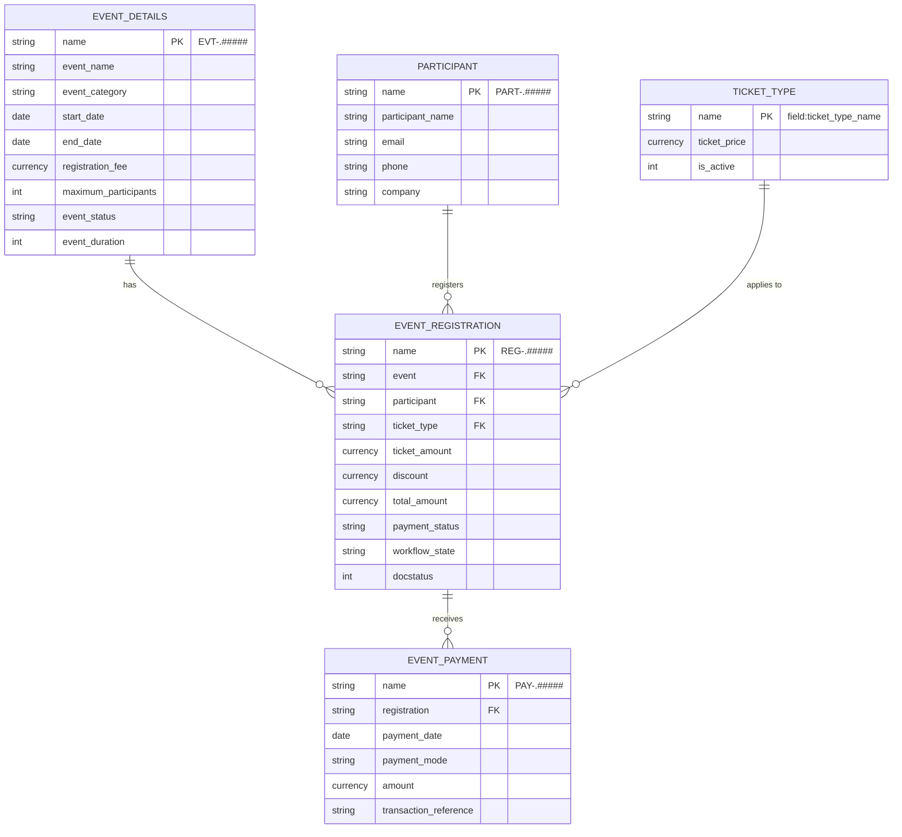

### DocType Summaries

1. **Event Details (`EVT-.#####`)**: Defines the event window, capacity, fee (informational), and status (`Draft`, `Open`, `Ongoing`, `Completed`, `Cancelled`). Duration is read-only and automatically calculated.
2. **Participant (`PART-.#####`)**: Attendee directory containing contact details.
3. **Ticket Type (`field:ticket_type_name`)**: Ticket master (e.g., Standard: ₹500, Premium: ₹1,000, VIP: ₹1,500). Has an `is_active` toggle.
4. **Event Registration (`REG-.#####`)**: Submittable document linking event, participant, and ticket. Manages `total_amount = ticket_amount - discount` and `workflow_state`.
5. **Event Payment (`PAY-.#####`)**: Non-submittable record capturing payment modes (Cash, UPI, Card, Bank Transfer) and synchronizing registration payment status.

---

## 6. Client-Side Scripts

### Event Details (`event_details.js`)
- **Inclusive Duration**: Automatically computes duration in calendar days:
  $$\text{Duration} = \lfloor(\text{End} - \text{Start}) / 86400000\rfloor + 1$$
  Same-day events evaluate to 1 day. Sets to `null` if dates are invalid.
- **Form Date Validation**: Prevents saving if End Date is before Start Date.
- **Navigation Shortcut**: Renders a **View Registrations** button on saved events that routes directly to filtered registrations.

### Event Registration (`event_registration.js`)
- **Event Information Banner**: Fetches and renders a clean blue alert showing event category, dates, and registration fee via `frm.set_intro()`. (Note: The fee is informational and not added to the ticket price).
- **Dynamic Ticket Pricing**: Queries `Ticket Type.ticket_price` via `frappe.db.get_value` and populates `ticket_amount`.
- **Real-Time Total**: Calculates `total_amount = ticket_amount - discount` whenever values change.
- **Client Validation**: Prevents negative discounts or discounts exceeding ticket amount.

---

## 7. Server-Side Validations & Logic

All business rules are enforced in Python controllers to prevent client-side bypass:

### Event Details (`event_details.py`)
- **Date Check**: Throws an error if `end_date < start_date`. Same-day events are permitted.

### Event Registration (`event_registration.py`)
1. **Duplicate Prevention**: Rejects duplicate registrations for the same participant and event while allowing edits on existing documents (`name != self.name`).
2. **Capacity Enforcement**: Counts active registrations (`Draft`, `Pending Approval`, `Approved`) against `maximum_participants`. `Rejected` registrations are excluded. Limit $\le 0$ or empty is treated as unlimited.
3. **Registration Window**: Ensures `registration_date` falls inclusively between `registration_start_date` and `registration_end_date`.
4. **Price Tamper Protection**: Re-fetches `ticket_price` and active status from the database, blocks inactive tickets, validates discount boundaries ($0 \le \text{discount} \le \text{price}$), and recalculates `total_amount` on the server.

### Event Payment (`event_payment.py`)
1. **Payment Amount Validation**: Rejects amounts $\le 0$ or amounts exceeding the outstanding balance ($\text{Total Amount} - \sum \text{Previous Payments}$).
2. **Automatic Status Synchronization**: In `on_update` and `on_trash`, recalculates total paid:
   - $\text{Total Paid} = 0 \rightarrow$ **Unpaid**
   - $0 < \text{Total Paid} < \text{Total Amount} \rightarrow$ **Partially Paid**
   - $\text{Total Paid} \ge \text{Total Amount} \rightarrow$ **Paid**
   Updates both prior and new registrations if a payment is reassigned.

---

## 8. Workflow & Role-Based Permissions

### Registration Approval Workflow
Configured using Frappe's built-in Workflow engine on `Event Registration`:

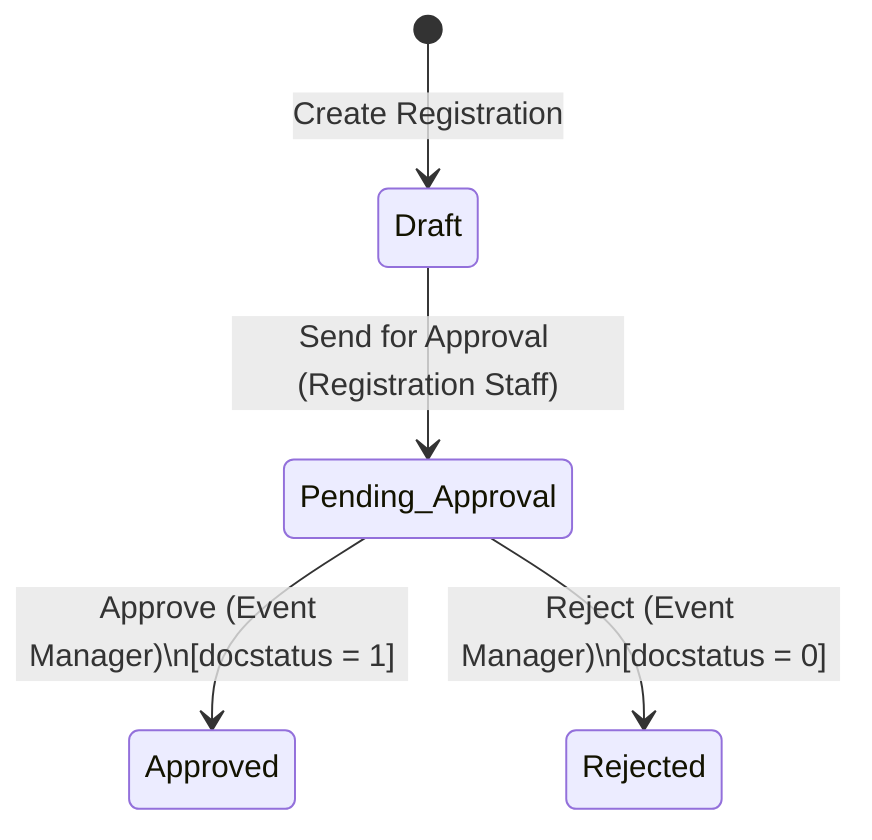

| State | DocStatus | Allowed Action | Allowed Role | Next State |
|---|:---:|---|---|---|
| **Draft** | 0 | Send for Approval | Registration Staff | Pending Approval |
| **Pending Approval** | 0 | Approve | Event Manager | Approved |
| **Pending Approval** | 0 | Reject | Event Manager | Rejected |
| **Approved** | 1 (Submitted) | — | — | Final |
| **Rejected** | 0 | — | — | Final |

### Role Permissions Matrix

| Role | Event Details | Participant | Ticket Type | Event Registration | Event Payment |
|---|:---:|:---:|:---:|:---:|:---:|
| **Registration Staff** | Read | Read, Write, Create | Read | Read, Write, Create | Read, Write, Create |
| **Event Manager** | Read, Write, Create | Read, Write | Read, Write, Create | Read, Write, Submit, Cancel | Read, Write, Create |
| **System Manager** | Full Access | Full Access | Full Access | Full Access | Full Access |

### Manager Registration Cancellation and Deletion

The registration details page provides Event Managers and System Managers with document actions governed by Frappe permissions:

- **Cancel registration** is available for submitted registrations. It uses the normal Frappe document cancellation lifecycle and sets `docstatus` to `2`.
- **Delete registration** is available only after cancellation. Frappe's normal delete operation and linked-document checks remain in effect.
- Both actions require manager-level portal access and the corresponding `Event Registration` permission. Registration Staff cannot use these actions.
- Cancelled registrations are excluded from event-capacity counts and are displayed as **Cancelled** in registration lists.

These actions are separate from the approval workflow; the existing approval and rejection transitions are unchanged.

---

## 9. Event Registration Report

- **Type**: Script Report (`Event Registration Report`)
- **Reference DocType**: `Event Registration`
- **Filter**: Optional `Event` Link filter (selecting blank returns all records).
- **Columns**: `Event Name`, `Participant Name`, `Email`, `Ticket Type`, `Total Amount`, `Payment Status`.
- **Query Strategy**: Uses SQL `LEFT JOIN` on `tabEvent Details` and `tabParticipant`, filtering by `docstatus < 2` to exclude cancelled records, ordered by `creation DESC`.

```sql
SELECT
    ed.event_name, p.participant_name, p.email,
    er.ticket_type, er.total_amount, er.payment_status
FROM `tabEvent Registration` er
LEFT JOIN `tabEvent Details` ed ON er.event = ed.name
LEFT JOIN `tabParticipant` p ON er.participant = p.name
WHERE er.docstatus < 2
  AND (%(event)s IS NULL OR er.event = %(event)s)
ORDER BY er.creation DESC;
```

---

## 10. Whitelisted REST APIs

All APIs are defined in `event_management/api.py` and require Frappe Token Authentication:
```http
Authorization: token <api_key>:<api_secret>
```

### 1. `get_available_events`
- **Endpoint**: `GET /api/method/event_management.api.get_available_events`
- **Description**: Returns all events with `event_status = 'Open'`, sorted by start date.
- **Response**:
```json
{
  "message": {
    "success": true,
    "message": "Available events retrieved successfully.",
    "data": [
      {
        "event_id": "EVT-00001",
        "event_name": "Tech Summit 2026",
        "event_category": "Conference",
        "start_date": "2026-12-01",
        "end_date": "2026-12-03",
        "registration_fee": 1000.0,
        "maximum_participants": 100,
        "event_status": "Open"
      }
    ]
  }
}
```

### 2. `get_event_details`
- **Endpoint**: `GET /api/method/event_management.api.get_event_details?event_id=EVT-00001`
- **Validation**: Requires `event_id`; validates event existence.
- **Success Response**: Returns full event details including duration and dates.
- **Error Response (Missing ID)**:
```json
{
  "message": {
    "success": false,
    "message": "Event ID is required.",
    "data": null
  }
}
```

### 3. `get_registered_participants`
- **Endpoint**: `GET /api/method/event_management.api.get_registered_participants?event_id=EVT-00001`
- **Description**: Retrieves attendees from **Approved** registrations (`workflow_state = 'Approved'`, `docstatus = 1`).
- **Response**:
```json
{
  "message": {
    "success": true,
    "message": "Registered participants retrieved successfully.",
    "data": {
      "event_id": "EVT-00001",
      "total_participants": 1,
      "participants": [
        {
          "registration_id": "REG-00001",
          "participant_id": "PART-00001",
          "participant_name": "Jane Doe",
          "email": "jane@example.com",
          "phone": "9876543210",
          "company": "Acme Corp",
          "ticket_type": "Standard",
          "registration_date": "2026-11-20",
          "total_amount": 500.0,
          "payment_status": "Paid"
        }
      ]
    }
  }
}
```

---

## 11. Testing & Validation Results

| Test Category | Test Scenario | Expected Outcome | Actual Result | Status |
|---|---|---|---|:---:|
| **DocType Setup** | Create and link records across all 5 DocTypes | Foreign keys and auto-naming format correctly | Verified schema integrity | Passed |
| **Client Scripts** | Modify start/end dates in Event Details | Duration updates dynamically; 1 day for same date | Accurate duration calculated | Passed |
| **Client Scripts** | Select Ticket Type in Event Registration | Ticket price fetches and sets total amount | Populated without refresh | Passed |
| **Server Validation** | Save event with End Date < Start Date | Throw error: "End Date cannot be earlier" | Save blocked | Passed |
| **Server Validation** | Register same participant for same event twice | Throw error: "Participant already registered" | Duplicate rejected | Passed |
| **Server Validation** | Exceed configured event capacity | Throw error: "Maximum participant capacity reached" | Overage rejected | Passed |
| **Server Validation** | Register outside event registration window | Throw error: "Date cannot be earlier/later" | Date boundaries enforced | Passed |
| **Server Validation** | Submit tampered ticket amount via client script | Server overwrites amount with database price | Database price enforced | Passed |
| **Server Validation** | Record payment greater than outstanding balance | Throw error with exact remaining balance | Overpayment blocked | Passed |
| **Payment Sync** | Create partial payment, then remaining payment | Status transitions: Unpaid → Partially Paid → Paid | Auto-updated via hooks | Passed |
| **Workflow** | Staff submits; Manager approves / rejects | State transitions and docstatus updates to 1 on approve | Permissions strictly enforced | Passed |
| **Report** | Filter report by specific event vs blank filter | Displays filtered events or all non-cancelled rows | Output matched SQL logic | Passed |
| **APIs** | Execute GET requests via Postman with Token Auth | JSON response matches expected envelope | Auth and responses verified | Passed |

---

## 12. Screenshots & Visual Documentation

The following screenshots demonstrate the main features and functionality of the Event Management System. All screenshots are stored in the `screenshots/` directory.

### 12.1 Event Management

<details>
<summary><b>01. Event Details Form</b></summary>

Shows the event information, dates, registration fee, participant capacity and event status.

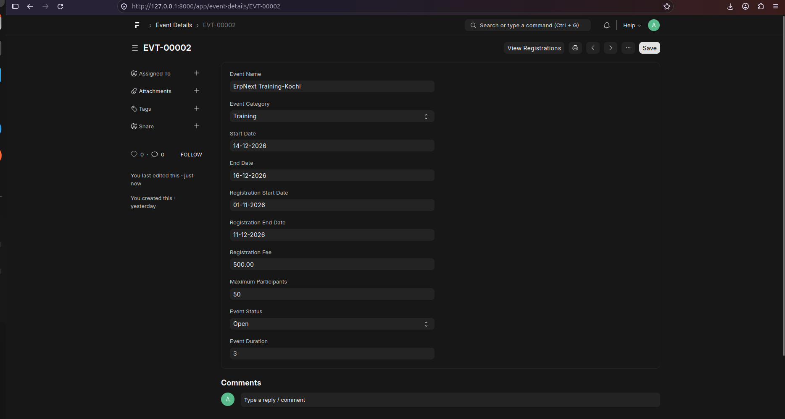

</details>

<details>
<summary><b>02. Event List</b></summary>

Displays the list of events created in the system.

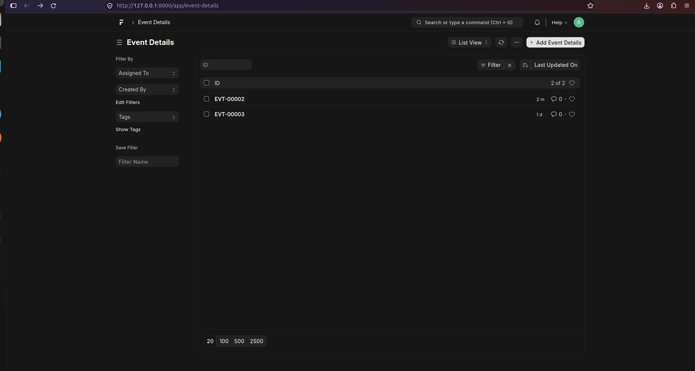

</details>

### 12.2 Participant and Ticket Management

<details>
<summary><b>03. Participant Form</b></summary>

Shows participant details, including name and contact information.

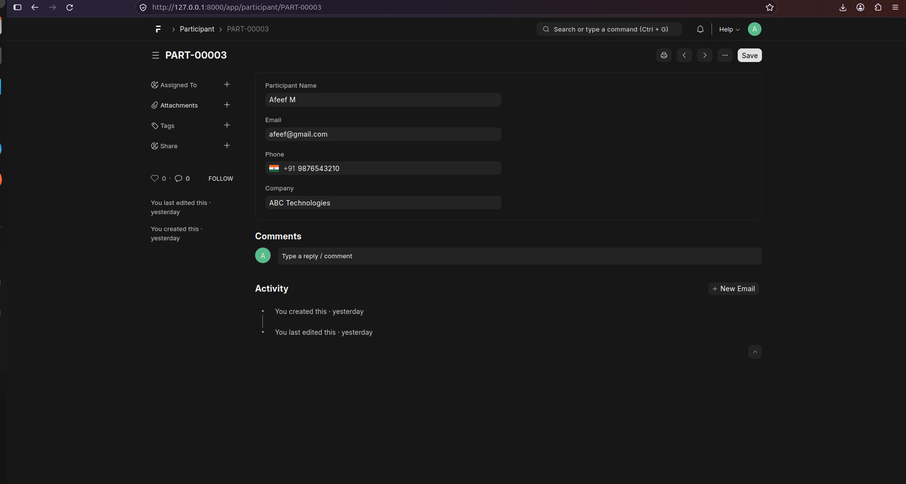

</details>

<details>
<summary><b>04. Ticket Type Form</b></summary>

Shows ticket type configuration and ticket pricing.

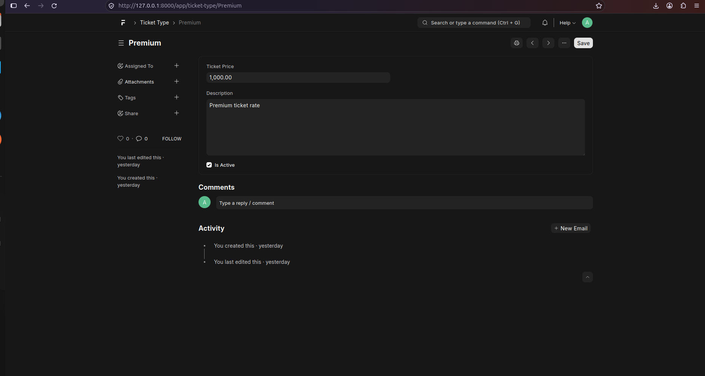

</details>

### 12.3 Event Registration and Validations

<details>
<summary><b>05. Event Registration Form</b></summary>

Shows the registration form linking an event, participant and ticket type.

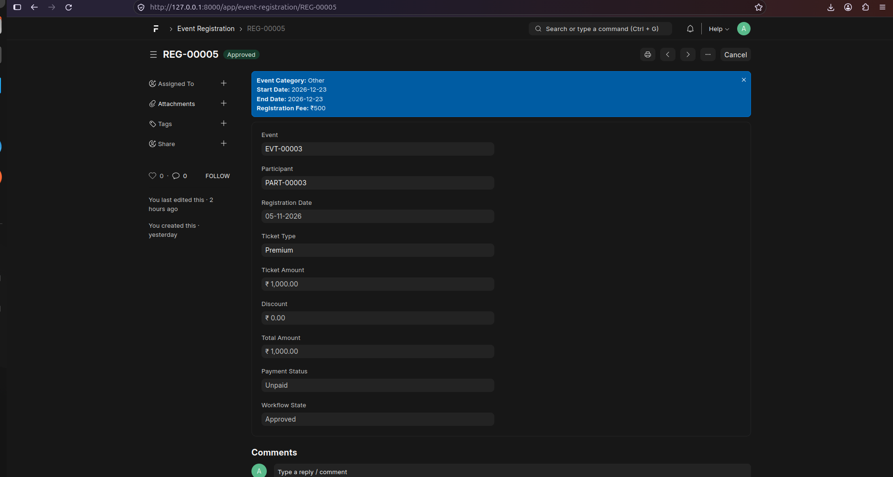

</details>

<details>
<summary><b>06. Automatic Calculation</b></summary>

Demonstrates automatic ticket amount fetching and total amount calculation.

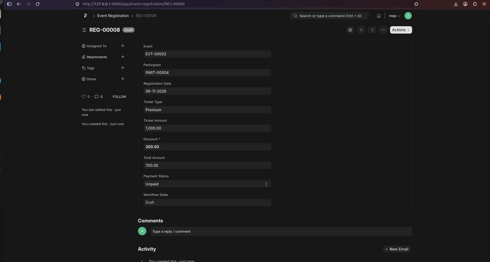

</details>

<details>
<summary><b>07. Server-Side Validation</b></summary>

Demonstrates an example of a validation error handled by the Python controller.

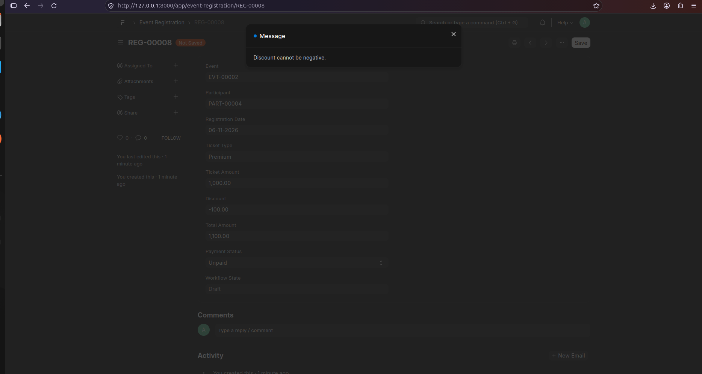

</details>

### 12.4 Approval Workflow

<details>
<summary><b>08. Pending Approval</b></summary>

Shows a registration submitted by Registration Staff and waiting for Event Manager approval.

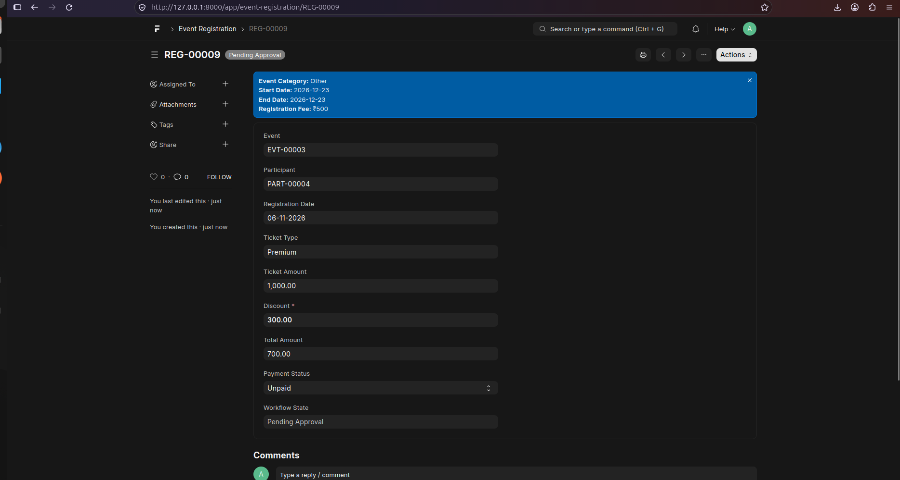

</details>

<details>
<summary><b>09. Approved Registration</b></summary>

Shows a registration after the Event Manager approves it.

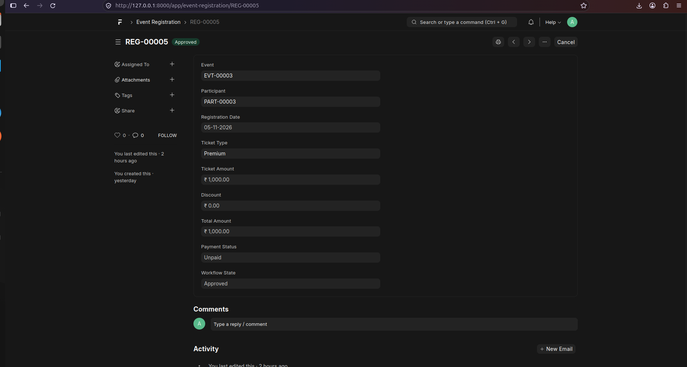

</details>

### 12.5 Payment Management

<details>
<summary><b>10. Event Payment</b></summary>

Shows the Event Payment form used to record participant payments.

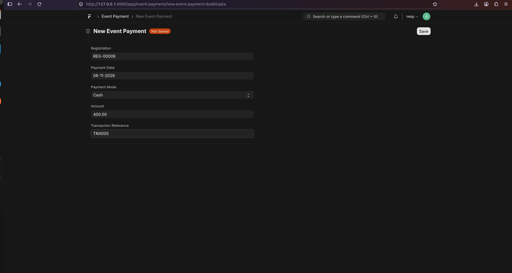

</details>

### 12.6 Reports and API Testing

<details>
<summary><b>11. Event Registration Report</b></summary>

Shows the Script Report displaying event registration and payment information.

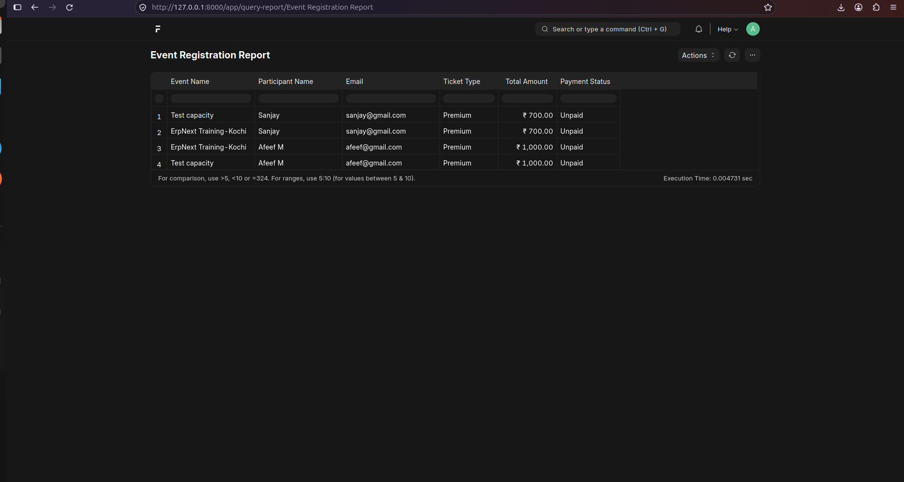

</details>

<details>
<summary><b>12. API Testing Using Postman</b></summary>

Shows an API request and its response tested using Postman.

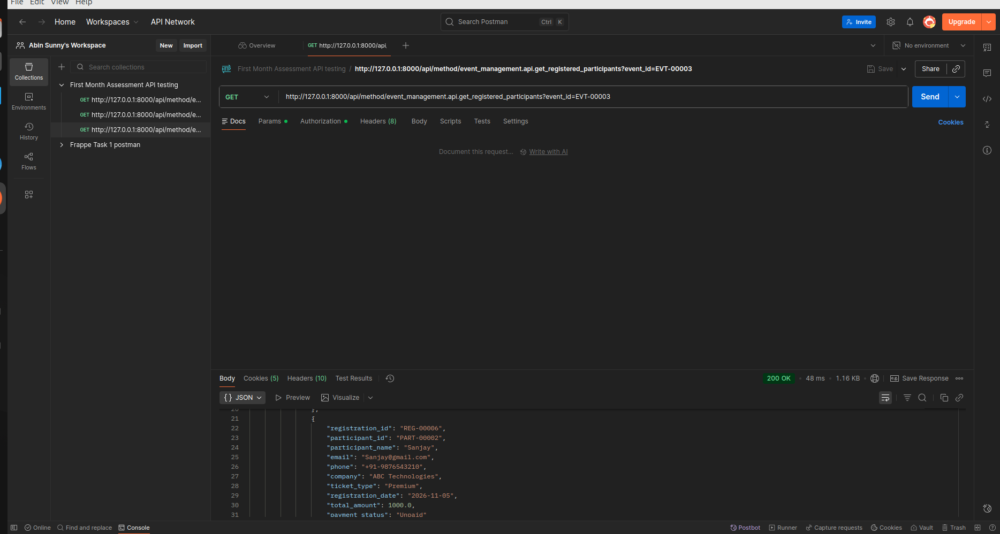

</details>

## 13. Installation & Setup

### Prerequisites
- Python $\ge$ 3.10
- MariaDB $\ge$ 10.6
- Frappe Bench CLI

### Setup Steps
```bash
# 1. Navigate to your bench directory
cd ~/frappe-bench

# 2. Get the app (replace with your repository path or URL)
bench get-app event_management /path/to/event_management --branch develop

# 3. Install app on your site
bench --site <your-site-name> install-app event_management

# 4. Migrate database schema and build assets
bench --site <your-site-name> migrate
bench build --app event_management

# 5. Start bench server
bench start
```

### Post-Installation Configuration
1. **Roles**: Ensure `Registration Staff` and `Event Manager` roles are assigned to appropriate test users.
2. **Workflow**: Verify that the `Event Registration Approval` workflow is set to **Active**.
3. **Ticket Types**: Create initial active ticket tiers (e.g., Standard, Premium, VIP).
4. **API Testing**: Generate an API Key and Secret under user settings in Frappe Desk and import the Postman collection located at `docs/postman/event_management_api.postman_collection.json`.

---

## 14. Future Enhancements

The following features are conceptual enhancements for subsequent iterations:
- **Attendance Module**: QR-code check-in scanning on event day.
- **Payment Gateways**: Integration with Razorpay / Stripe for self-service checkout.
- **Automated Notifications**: Email triggers on registration approval and ticket dispatch.
- **Analytics Dashboard**: Real-time charts for revenue, capacity fill rates, and ticket popularity.
- **Automated Unit Tests**: Expanding `test_*.py` test suites with end-to-end `FrappeTestCase` fixtures.

---

## 15. Conclusion

The **Event Management System** is a robust, clean implementation of an enterprise event workflow built natively on the Frappe Framework. By combining custom DocTypes, client-side UI assists, strict server-side controllers, role-based workflows, SQL reports, and REST APIs, the system provides EventPro Solutions with complete operational control and data integrity across all events.
